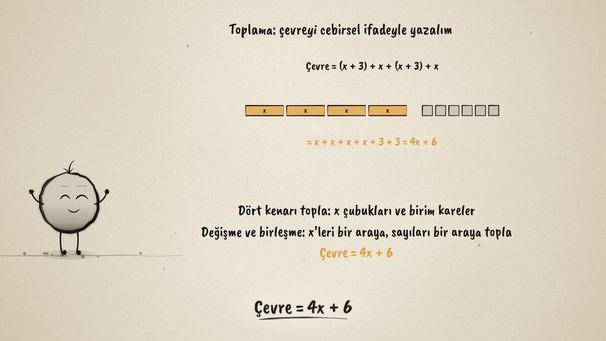
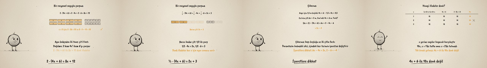

# Çit Ne Kadar? · Operations with Algebraic Expressions

**▶ Tarayıcıda izleyin / Watch in the browser:** https://hakanatas.github.io/cit-ne-kadar/ 
**⬇ MP4 + altyazılar / MP4 + subtitles:** [Releases](https://github.com/hakanatas/cit-ne-kadar/releases) 
**✎ Kullanılan istem / The prompt behind it:** [PROMPT.md](PROMPT.md) 
**🎞 Bütün filmler / All films:** [Nokta'nın Filmleri](https://hakanatas.github.io/nokta-filmleri/?sinif=7)

> **TR —** 7. sınıf matematik "İşlemlerle Cebirsel Düşünme ve Değişimler" temasındaki MAT.7.2.1 öğrenme çıktısı için hazırlanmış, tamamen JavaScript ile çizilen 92 saniyelik mürekkep animasyonu. Kenarları x m ve x + 3 m olan dikdörtgen bir bahçeye çit çekilecek. Çevre cebir karolarıyla yazılıyor, (x + 3) + x + (x + 3) + x; değişme ve birleşme özellikleriyle karolar yer değiştirip 4x + 6'da toplanıyor. İki bahçe için çit 2 katına çıkıyor: dağılma özelliğiyle 2 · (4x + 6) = 8x + 12; x = 5 için ikisi de 52. Yarım çit için 1/2 ile çarpılıyor: 2x + 3. Çıkarmada kapı boşluğu (4x + 6 − 1,5 = 4x + 4,5) ve iki çitin farkı ((6x + 2) − (4x + 6) = 2x − 4) hesaplanıyor; parantezin önündeki eksi her terimin işaretini değiştiriyor. Son olarak bir değer tablosu denkliği açıklıyor: (x + 3) + x + (x + 3) + x, 4x + 6 ve 2 · (2x + 3) her x için aynı; 10x, x = 1'de tutsa da x = 2'de tutmuyor, denk değil. Altyazılar Türkçe, İngilizce ya da ikisi birlikte seçilebilir.

A 92-second ink animation for **7th-grade maths**. Nokta, the ink character from [The Learning Ink](https://github.com/hakanatas/the-learning-ink), is the guide again. The algebra tiles are laid out by one function (`layout` in `scenes/scene1.js`) for the perimeter as written and for the perimeter grouped, and each tile slides from one place to the other, so the commutative and associative properties can be watched rather than only named.

## Learning outcome

MEB, Türkiye Yüzyılı Maarif Modeli, Ortaokul Matematik, 7th grade, "İşlemlerle Cebirsel Düşünme ve Değişimler" theme:

**MAT.7.2.1. Gerçek yaşam durumları ya da matematiksel durumlar üzerinden cebirsel ifadelerle toplama, çıkarma ve bir rasyonel sayıyla çarpma işlemlerini yorumlayabilme**
- a) Gerçek yaşam durumlarına ya da matematiksel durumlara karşılık gelen cebirsel ifadelerle işlemleri inceler.
- b) Toplama ve çarpma işlemlerinin özelliklerini, cebirsel ifadelerde işlem yaparken kullanır.
- c) Bu işlemler ve sonuçları arasındaki denkliği açıklar.

## Scenes

| # | Time | Scene | What happens | Outcome |
|---|---|---|---|---|
| 1 | 0–10 s | Bahçe | A garden x by x + 3: how much fence? | a |
| 2 | 10–28 s | Toplama | Tiles regroup (x + 3) + x + (x + 3) + x into 4x + 6. | a, b |
| 3 | 28–46 s | Çarpma | 2 · (4x + 6) = 8x + 12 (both 52 for x = 5); ½ · (4x + 6) = 2x + 3. | b, c |
| 4 | 46–64 s | Çıkarma | 4x + 6 − 1.5; (6x + 2) − (4x + 6) = 2x − 4. | a, b |
| 5 | 64–80 s | Denklik | A table for x = 1, 2, 3; 10x agrees once, then fails. | c |
| 6 | 80–92 s | Aklında kalsın | Like terms, distributing, signs, equivalence. | a–c |

## Running it

- **Preview:** double-click `index.html` (it works offline).
- **MP4:** run `npm install` once, then `npm run export -- --format=horizontal --captions=tr`.
- **Subtitles and narration:** `npm run srt` writes `out/captions_*.srt` and `narration_notes.txt`.
- **Editing:**
  - Caption text, timings and narration notes: `captions.js`
  - Everything on screen is drawn by `LI.world(t)` in `scenes/scene1.js` (the garden, the tiles, the working, the table, the words); the other scenes only set the camera.
  - Nokta's poses: `src/draw/film.js`; layout for 16:9 and 9:16: `src/draw/kd.js`

It uses the same engine as The Learning Ink: `renderFrame(t)` as a pure function of time, seeded randomness, and frame-by-frame export.

## Lisans · License

**TR —** Bu film ve kodu [Creative Commons Atıf-GayriTicari 4.0 Uluslararası (CC BY-NC 4.0)](https://creativecommons.org/licenses/by-nc/4.0/deed.tr) lisansıyla paylaşılır. Ticari olmayan her amaçla (derste, okulda, eğitim materyalinde) kopyalayabilir, paylaşabilir ve değiştirebilirsiniz; ancak **kaynak göstermek zorunludur**: eser sahibinin adı ve bu deponun bağlantısı belirtilmeden kullanılamaz. Ticari kullanım (satış, ücretli ürün ya da yayın) için izin alınmalıdır.

**EN —** This film and its code are licensed under [Creative Commons Attribution-NonCommercial 4.0 International (CC BY-NC 4.0)](https://creativecommons.org/licenses/by-nc/4.0/). You may copy, share and adapt them for non-commercial purposes, but **attribution is required**: they may not be used without crediting the author and linking to this repository. Commercial use requires permission.

Atıf örneği / Required credit: *“Çit Ne Kadar?”, Hakan Ataş, Nokta'nın Filmleri — https://github.com/hakanatas/cit-ne-kadar — CC BY-NC 4.0*
